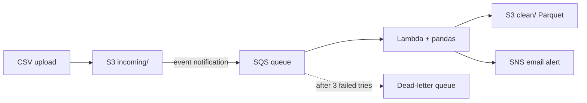

# Event-Driven Data Pipeline on AWS

Upload a CSV to S3 and it is cleaned automatically and saved as Parquet.
A success or failure email is sent for every file.

## Architecture

## Services used

S3, SQS (with a dead-letter queue), Lambda, SNS, IAM, CloudWatch

## What the cleaning step does

- Removes duplicate rows
- Trims extra spaces in text columns
- Fills missing numbers with the column median
- Drops rows with a negative Fare or Salary

## How it works

1. A CSV is uploaded to the `incoming/` prefix of the bucket.
2. S3 sends an event to an SQS queue (prefix `incoming/`, suffix `.csv`).
3. Lambda reads the message, cleans the file with pandas and writes Parquet to `clean/`.
4. SNS emails a success or failure message.
5. A file that fails 3 times is moved to the dead-letter queue.

## Setup

1. Create an S3 bucket with `incoming/` and `clean/` prefixes.
2. Create an SNS topic and confirm an email subscription.
3. Create an SQS queue and a dead-letter queue (max receives = 3).
4. Create an IAM role for Lambda using `policies/lambda-role-policy.json`.
5. Create the Lambda function (Python 3.12) with the AWSSDKPandas layer, the
   code in `lambda_function.py`, and the environment variable `SNS_TOPIC_ARN`.
6. Apply `policies/sqs-access-policy.json` to the main queue.
7. Add the S3 event notification and the SQS trigger on Lambda.
8. Upload a file from `sample_data/` to `incoming/`.

Replace `<ACCOUNT_ID>` in the policy files with your own AWS account number.

## Sample data

`sample_data/` has three CSVs with deliberate problems (duplicates, extra
spaces, missing values) for testing the cleaning step.

## What I learned

- IAM least privilege (separate permissions for read, write and publish)
- S3 event notifications and prefix filters
- Retries and dead-letter queues in SQS
- Debugging with CloudWatch logs: I traced a NoSuchKey error to a hidden
  space in an S3 folder name

## Next steps

Partitioned Parquet, Athena queries over the clean data, a Glue crawler,
and infrastructure as code.
